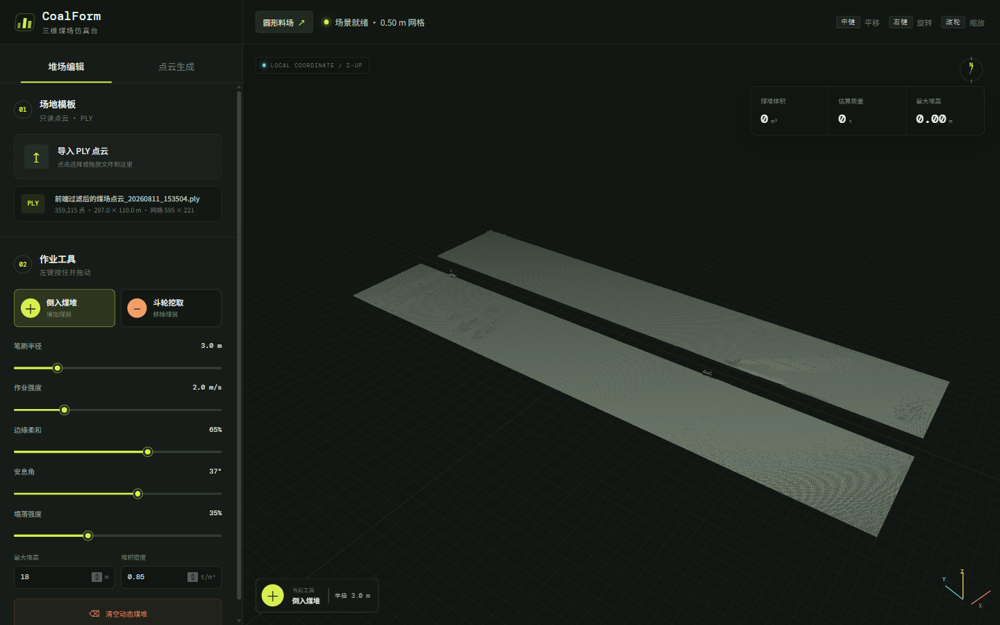
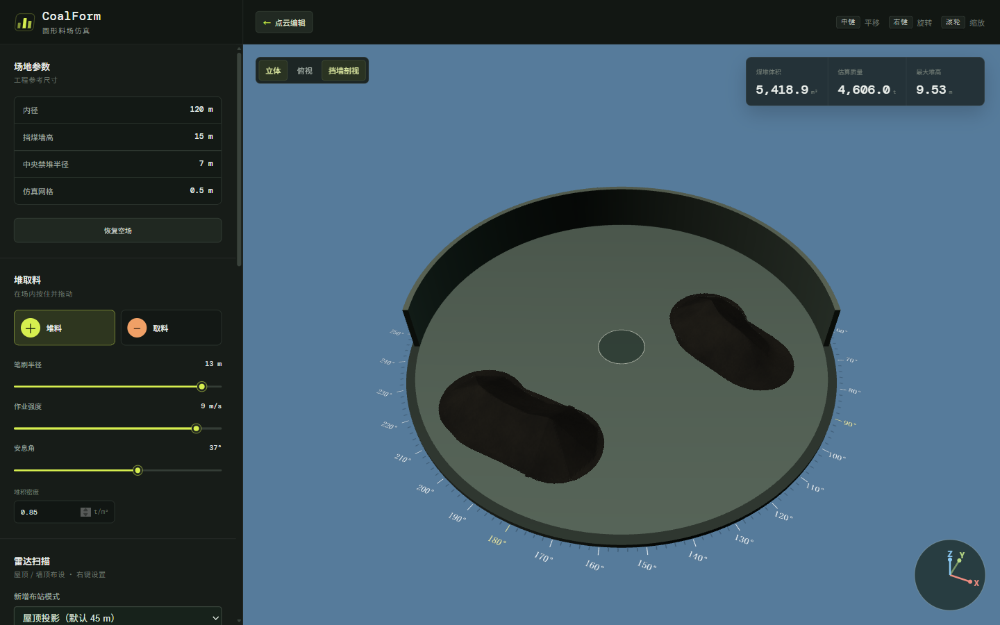

# CoalForm 三维煤场堆煤仿真

CoalForm 是一个在浏览器中运行的三维煤场堆取料仿真工具，提供条形场和圆形料场两个工作区。

- **条形场**支持导入 ASCII 或二进制 PLY 点云作为场地模板。可用笔刷堆煤、取煤，并沿源点云的扫描网格生成更新后的 PLY。
- **圆形料场**提供带挡煤墙和中央禁堆区的仿真场地。可编辑煤堆、布设屋顶或墙顶雷达、生成扫描快照，并导出煤面 PLY 或雷达扫描 ZIP。

## 界面截图

### 条形场 · 导入 PLY 点云



### 圆形料场



## 运行

```powershell
npm install
npm run dev
```

在浏览器中打开终端显示的本地地址。条形场需在「导入 PLY 点云」区域选择或拖放自己的 PLY 文件。点击顶部的「圆形料场」即可打开圆形工作区。

生产构建与测试：

```powershell
npm test
npm run build
```

## 操作

- 左键按住并拖动：使用当前倒煤或挖煤笔刷；
- 中键拖动：平移视角；
- 右键拖动：旋转视角；
- 滚轮：缩放；
- `Shift + 滚轮`：调整笔刷半径；
- `Ctrl + 滚轮`：调整作业强度。

“点云生成”页无需设置雷达位置或采样点数。系统逐条复用源点的 XY 坐标、文件顺序和强度，只对煤堆覆盖范围内且接近局部地面的点修改 Z。煤堆主体和坡脚接触区若存在源网格空洞，会按相同扫描方向、间距和相位补点；补点复制最近源记录的强度及其他非坐标属性。输出保留源文件的 ASCII/二进制编码、顶点属性顺序和数据类型。高于地面容差的设备、围墙等静态点不会被替换。

补点高程使用附近多行源点残差的连续加权插值，并限制在测量噪声尺度内；坡脚采用连续紧支撑核生成，且补点前进行实际 XY 邻近检查。因此不会因最近模板切换、离散距离环或全局网格轻微相位漂移形成周期性条纹或重复点列。

## 数据约束

- 原始场地点云与地面高度数组不会被笔刷修改；
- 动态煤层厚度始终不小于零；
- 清空操作只重置动态煤层；
- 模式 B+ 不随机撒点或删除点；原点只原位替换，新增点仅用于补齐煤堆主体和坡脚接触区的源扫描网格空洞。

## 许可证

项目代码采用 [GNU General Public License v3.0](LICENSE)（`GPL-3.0-only`）。当前版本不附带原始 PLY 点云数据。
