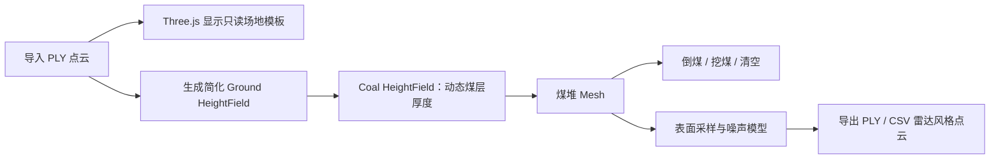
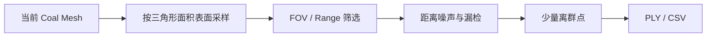

# 三维煤场堆煤仿真——方案 A：纯前端 MVP

> 定位：最快实现可演示闭环的单页面浏览器应用。
>
> 核心原则：**场地点云只读；煤堆作为独立的高度层编辑；雷达输出采用几何型“雷达风格点云”。**

---

## 1. 目标

在浏览器中完成以下功能：

1. 导入一份 PLY 点云作为固定煤场模板；
2. 场地点云始终只读、只显示，不因堆煤或挖煤被修改；
3. 使用类似城市建造类游戏地形工具的鼠标笔刷倒煤；
4. 使用鼠标笔刷模拟斗轮机挖煤；
5. 一键清空所有动态煤堆；
6. 使用中键平移、右键旋转、滚轮缩放来浏览场景；
7. 根据当前煤堆生成并导出带简单噪声的雷达风格点云。

本方案的重点是**验证交互、数据模型和输出闭环**，而不是复现煤颗粒物理或真实毫米波雷达信号链。

---

## 2. 范围与非目标

### 2.1 第一版包含

- PLY（ASCII 或二进制）文件导入；
- 固定场地点云显示；
- 从点云创建简化地面高度网格；
- 煤堆高度场编辑和可视化网格；
- 倒煤、挖煤、清空；
- 笔刷半径、强度、软边缘参数；
- 三维视角导航；
- 煤堆体积、最大堆高统计；
- 单个虚拟雷达位置与视场配置；
- 当前煤堆的雷达风格点云导出（PLY、CSV）。

### 2.2 第一版明确不包含

- 直接增删或移动原始场地点云；
- LAS/LAZ、PCD 等格式支持；
- Python/FastAPI 后端、数据库、登录和多用户协作；
- Potree、超大规模点云流式加载；
- 真实煤颗粒离散元（DEM）物理仿真；
- 真实斗轮机模型、轨道、臂架运动学和扫掠切削；
- 静态设备的精确碰撞与雷达遮挡；
- FMCW 波形、RCS、多径、Doppler、CFAR 等高保真毫米波雷达物理仿真；
- Undo / Redo（可在基础闭环完成后增加）。

---

## 3. 总体架构



系统仅包含浏览器前端：

```text
Vite + TypeScript + Three.js
```

可选依赖：

```text
lil-gui           参数调试面板
three-mesh-bvh    后续需要精确射线遮挡时再安装
```

---

## 4. 核心数据模型

```ts
interface HeightField {
  rows: number
  cols: number
  cellSize: number
  originX: number
  originY: number
  ground: Float32Array  // 只读地面高度
  coal: Float32Array    // 动态煤层厚度，初始为 0
  enabled: Uint8Array   // 是否允许堆煤/挖煤
}
```

任意网格单元的最终表面高度为：

```text
surfaceHeight = groundHeight + coalThickness

coalThickness >= 0
```

这三个约束确保：

- 原始点云不被修改；
- 挖煤不会低于地面；
- 清空只需将 `coal` 全部置零；
- 可直接计算煤堆体积；
- 煤堆网格与雷达点云都可由同一份状态重建。

---

## 5. 点云导入与地面高度网格

### 5.1 输入

第一版仅支持 `.ply`：

```text
x, y, z
intensity（若文件携带则保留，用于显示）
```

Three.js 的 `PLYLoader` 读取点云，使用 `THREE.Points + BufferGeometry` 显示。

### 5.2 坐标处理

导入后根据点云包围盒进行局部化：

```text
localX = x - minX
localY = y - minY
localZ = z - minZ
```

局部坐标可避免将来导入大工程坐标时出现 WebGL 浮点精度抖动。

### 5.3 简化 Ground HeightField 生成

推荐先固定：

```text
cellSize = 0.5 m
```

处理步骤：

1. 根据点云的 XY 包围盒创建规则网格；
2. 将点放入对应格子；
3. 每个格子取最低点高度，作为简化地面高度；
4. 对空格使用邻近格的高度填补；
5. 默认全区域可操作，或由用户指定一个矩形堆煤区；
6. 堆煤区以外 `enabled = 0`，笔刷不能修改。

> 说明：取最低点是 MVP 的简化假设。现场包含设备、围墙、皮带或已有煤堆时，应由用户划定有效堆料区。后续版本再增加地面分类、禁堆区、多边形区域与静态障碍物。

---

## 6. 煤堆可视化

根据高度场生成规则三角网格：

```text
顶点高度 Z = ground[index] + coal[index]
```

建议样式：

- 煤堆颜色为深灰/褐黑；
- 使用 `MeshStandardMaterial`；
- 开启平滑法线和阴影；
- 只在 `coal > 0` 或其邻域存在煤层的区域显示煤堆面；
- 地面点云持续显示在煤堆周围作为模板参照。

对于当前样本规模，先创建一张完整煤堆网格即可。笔刷后只更新顶点 `position.z` 和法线；实测性能不足时再分块更新。

---

## 7. 交互设计

| 输入 | 功能 |
|---|---|
| 左键点击/拖动 | 当前工具作用：倒煤或挖煤 |
| 中键按住拖动 | 平移视角 |
| 右键按住拖动 | 旋转视角 |
| 滚轮 | 缩放视角 |
| Shift + 滚轮 | 调整笔刷半径（可选） |
| Ctrl + 滚轮 | 调整笔刷强度（可选） |

使用 `OrbitControls` 并改写鼠标映射即可。

### 7.1 笔刷拾取规则

左键操作时，应优先让射线与煤堆网格相交；无煤堆时与地面高度网格的渲染代理面相交。

不要将稀疏点云本身作为主要拾取对象，因为点拾取结果会受点大小和视角影响。

---

## 8. 倒入煤堆工具

用户选择“倒入煤堆”后，在鼠标位置显示半透明圆形笔刷。

参数：

```text
radius：笔刷半径（m）
strength：堆煤强度（m/s）
falloff：边缘衰减
maxHeight：可选最大煤层高度（m）
```

对于笔刷范围内的格子：

```ts
t = Math.max(0, 1 - distance / radius)
falloff = t * t * (3 - 2 * t)

coal[index] += strength * falloff * deltaTime
```

为了避免鼠标移动过快造成断点，需要在上一笔刷中心到当前中心之间补点：

```text
sampleSpacing <= radius * 0.25
```

### 8.1 可选的自然坡面

第一版可先只采用软边缘笔刷。若煤堆坡面过陡，再在受影响区域做少量邻格松弛：

```text
当相邻格的高差超过允许坡度时，
将部分煤层厚度从高格迁移到低格。
```

这比颗粒 DEM 简单很多，视觉效果已足够接近自然煤堆。

---

## 9. 斗轮机挖取工具

第一版将斗轮机定义为“带工业语义的挖煤笔刷”，不模拟实体斗轮机。

参数：

```text
cutWidth：挖取宽度
cutDepthPerSecond：挖取强度（m/s）
edgeFalloff：边缘衰减
```

可使用椭圆笔刷，更接近沿斗轮切削方向的形状。

```ts
coal[index] = Math.max(
  0,
  coal[index] - cutStrength * falloff * deltaTime
)
```

因为煤层厚度始终不小于零，所以不会挖穿固定场地。

---

## 10. 一键清空

```ts
field.coal.fill(0)
updateCoalMesh()
```

清空只影响动态煤层：

```text
场地点云：不变
Ground HeightField：不变
Coal HeightField：全部归零
```

UI 应提供二次确认弹窗，避免误操作。

---

## 11. 煤量统计

每个网格的煤体积为：

```text
V_cell = coalThickness × cellSize²
```

总煤量：

```text
V_total = Σ V_cell
```

若用户填写堆积密度 `rho`（单位：t/m³）：

```text
mass = V_total × rho
```

建议实时显示：

```text
煤堆体积（m³）
估算质量（t）
最大煤层高度（m）
```

---

## 12. 雷达风格点云——方案 A

### 12.1 定位

此方案输出的是：

> 从指定虚拟雷达位置观察当前煤堆、带有简单测量噪声的几何型点云。

它适合：

- 演示与可视化；
- 点云算法接口联调；
- 堆体识别和体积估计算法的基础测试；
- 验证雷达位置、视场和量程的配置流程。

它不等同于真实 FMCW 毫米波雷达数据，未模拟 RCS、多径、波束、速度、多普勒和 FFT/CFAR 信号处理。

### 12.2 最简算法：煤堆表面采样

输入雷达参数：

```ts
interface RadarConfig {
  position: [number, number, number]
  yawDeg: number
  pitchDeg: number
  horizontalFovDeg: number
  verticalFovDeg: number
  minRange: number
  maxRange: number
  sampleCount: number
  rangeNoiseSigma: number
  dropoutRate: number
  outlierRate: number
}
```

生成步骤：

1. 从当前煤堆 Mesh 的三角形表面按面积随机采样；
2. 对每个采样点计算相对于雷达的距离、方位角和俯仰角；
3. 只保留落在雷达水平/垂直视场与量程范围内的点；
4. 对保留点加入高斯距离噪声；
5. 按 `dropoutRate` 随机删除部分点；
6. 按 `outlierRate` 添加少量随机离群点；
7. 输出 XYZ、range、azimuth、elevation、intensity 等字段。



### 12.3 已知简化

方案 A 不计算严格的前后遮挡，因此理论上可能保留煤堆背面的部分采样点。对于首个演示版本，这是可接受的成本/效果折中。

如需遮挡正确的结果，在第二阶段增加 `three-mesh-bvh`：按水平角 × 垂直角发射射线，只保留煤堆网格的第一交点。系统其余架构不需要改变。

### 12.4 导出格式

第一版只输出：

- `PLY`：便于再加载到 Three.js/Open3D 等工具中查看；
- `CSV`：便于快速检查和算法调试。

CSV 字段建议：

```text
x,y,z,range,azimuth,elevation,intensity
```

---

## 13. 文件与模块建议

```text
src/
├── main.ts
├── scene/
│   ├── SceneController.ts
│   ├── PointCloudLayer.ts
│   ├── CoalMeshLayer.ts
│   ├── BrushOverlay.ts
│   └── CameraControls.ts
├── simulation/
│   ├── HeightField.ts
│   ├── GroundGridBuilder.ts
│   ├── BrushEngine.ts
│   ├── CoalRelaxation.ts
│   ├── VolumeCalculator.ts
│   └── RadarStylePointCloud.ts
├── io/
│   ├── PlyImporter.ts
│   └── PointCloudExporter.ts
└── ui/
    └── ControlPanel.ts
```

---

## 14. 依赖安装

创建项目：

```powershell
npm create vite@latest coal-pile-simulator -- --template vanilla-ts
cd coal-pile-simulator
npm install three lil-gui
npm install -D @types/three
```

第二阶段若加入严格射线遮挡：

```powershell
npm install three-mesh-bvh
```

本方案第一版不依赖 Conda、Python、FastAPI、Open3D、PDAL 或数据库。

---

## 15. 验收标准

完成以下闭环即判定方案成立：

1. 导入一份 PLY 场地点云；
2. 浏览器稳定显示固定点云模板；
3. 自动创建地面高度网格；
4. 使用倒煤工具连续画出煤堆；
5. 使用斗轮机挖取工具减少煤堆；
6. 挖煤后任意位置不低于地面高度；
7. 使用一键清空移除全部煤层，固定点云不变；
8. 支持中键平移、右键旋转与滚轮缩放；
9. 显示煤堆体积和最大堆高；
10. 配置一个雷达位置、朝向、视场和量程；
11. 从当前煤堆导出一份可重新加载查看的 PLY 或 CSV 点云。

---

## 16. 后续升级路径

```text
纯前端 PLY MVP
→ Undo / Redo
→ 局部坡度松弛
→ 精确射线遮挡（three-mesh-bvh）
→ PCD、LAS/LAZ 输入输出
→ 后端预处理与项目保存
→ 超大点云 LOD / Potree
→ 真实斗轮机运动学
→ 高保真 FMCW 雷达仿真
```

## 一句话结论

**先用 Three.js 在浏览器中显示只读 PLY 场地点云，以高度场记录动态煤层，用鼠标笔刷堆煤与挖煤，再从煤堆网格表面采样生成带噪 PLY/CSV 点云；这是一条依赖最少、最容易快速验证的实现路线。**
